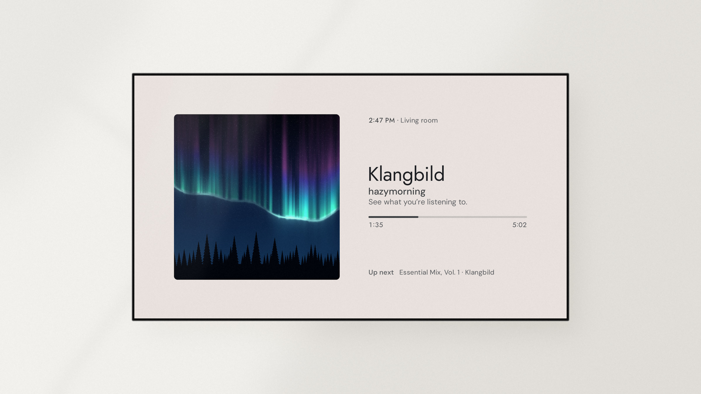
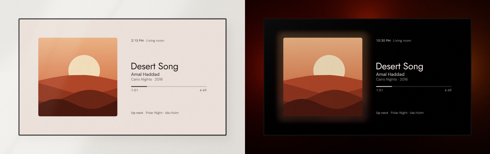
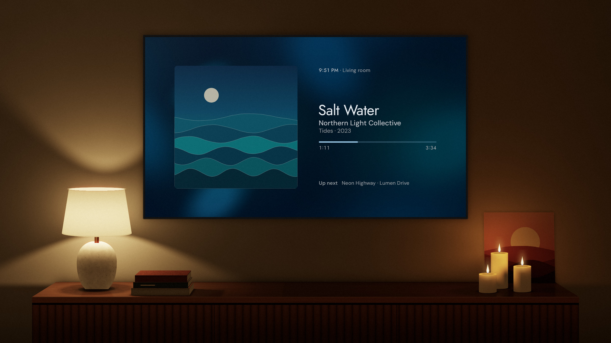
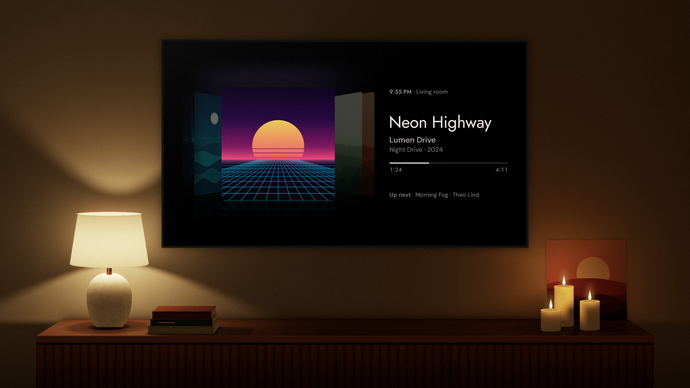
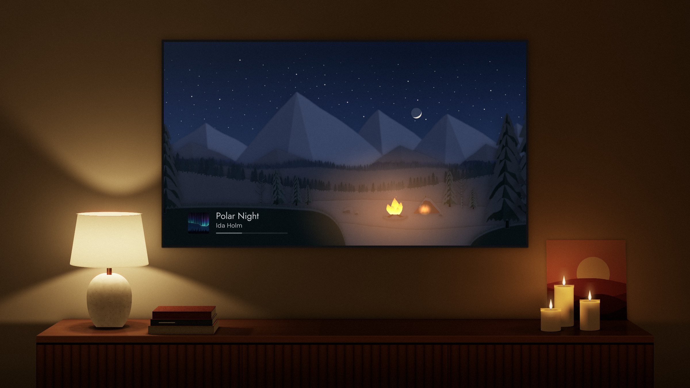

# Klangbild

Klangbild is a now playing screen for Android TV that works with Home Assistant.

[](#setup)
[](https://www.home-assistant.io)

<picture>
  <source media="(prefers-color-scheme: dark)" srcset="docs/screenshots/mockup-now-playing.jpg">
  
</picture>

When you're listening to music at home, the TV usually just sits there. Switched off, it's a big black screen that's hard to ignore, and switched on, it's bright and busy in a way that doesn't suit the music. Klangbild gives it something calm to show instead.

<a href="https://github.com/hazymorning/Klangbild/releases/latest"><picture><source media="(prefers-color-scheme: dark)" srcset="docs/screenshots/download.png"></picture></a>

## What it does

Klangbild works with any media player in Home Assistant and shows the album cover, the song and what's coming up next. With Music Assistant it can also show the queue, synced lyrics, and chapters for audiobooks and podcasts. Klangbild can also color smart lights behind the TV to match the album cover.

The background is light during the day and dark at night, and the picture slowly shifts by a few pixels to help prevent burn-in on OLED screens.



## Views

<table>
  <tr>
    <td width="33%" valign="top">
      <br>
      <b>Single cover</b>
    </td>
    <td width="33%" valign="top">
      <br>
      <b>Cover Flow</b>
    </td>
    <td width="33%" valign="top">
      <br>
      <b>Landscape</b>
    </td>
  </tr>
</table>

Single cover shows one large album cover next to the song details, and Cover Flow shows the covers in your queue side by side. Landscape is a cozy natural scene with a small player in the corner. You can switch views in the quick settings, or press up on the remote to go straight to the landscape.

<details>
<summary><b>More about the landscape</b></summary>
<br>

The landscape changes with the time of day and the seasons at your location, so you'll see morning light, a sunset or stars depending on when you look. If you have a weather entity in Home Assistant, it also shows the current weather, so you'll see rain on screen when it's raining outside.

By default, the landscape comes up by itself after three minutes without music. You can change that or turn it off in the settings.

</details>

## Setup

You need a TV with Android TV 9 or later and Home Assistant.

<details>
<summary><b>1. Install Klangbild on your TV</b></summary>
<br>

Klangbild isn't on Google Play, so you have to install the APK from the [latest release](https://github.com/hazymorning/Klangbild/releases/latest) yourself. The easiest way is the free Downloader app. Open the release page in Downloader, select the APK and allow the installation from unknown sources when Android asks. If you have developer options enabled, `adb install` works too.

</details>

<details>
<summary><b>2. Connect it to Home Assistant</b></summary>
<br>

When you open Klangbild, it shows a QR code. Scan it with your phone, sign in to Home Assistant and choose the speaker you want Klangbild to show. The whole setup happens on your phone, so you don't need to type anything with the remote.

You can set up Music Assistant, your lights and custom buttons on the same page, either right away or later.

</details>

<details>
<summary><b>Tip: let Home Assistant open Klangbild when the music starts</b></summary>
<br>

If your TV is connected to Home Assistant through the Android Debug Bridge integration, Home Assistant can open apps on it, and that includes Klangbild. The integration starts an app with the `media_player.select_source` action and the app's ID as the source, so a small automation like this one brings Klangbild up whenever your speaker starts playing:

```yaml
triggers:
  - trigger: state
    entity_id: media_player.living_room
    to: playing
actions:
  - action: media_player.select_source
    target:
      entity_id: media_player.tv
    data:
      source: io.github.hazymorning.klangbild
```

Replace the two entity IDs with your speaker and your TV. If you also add Klangbild to the integration's application list, it shows up by name among the TV's sources, so you can pick it there like any other app.

</details>

## Remote

| Button | Action |
| --- | --- |
| OK | Play or pause (hold to open the settings) |
| Left / Right | Previous or next song |
| Up | Switch to the landscape |
| Down | Open the quick settings |

In the quick settings you can switch views and add your own Home Assistant buttons, for example one that groups all your speakers.

## Contributing

Klangbild is a small project made for the joy of it, and help is very welcome. Whether you'd like to fix a bug, add a language or bring Klangbild to another TV platform, feel free to open a discussion or a pull request.

## Privacy

Klangbild doesn't have accounts or tracking. Your Home Assistant login is stored encrypted on the TV and is only sent to your own Home Assistant.
