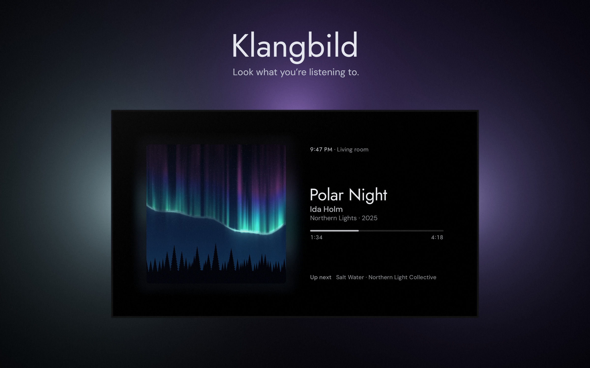

Klangbild turns your Android TV into a now playing screen for Home Assistant. You play music the way you always do, and the TV shows the cover, the song and what's coming up next.

## What it works with

Klangbild works with any media player in Home Assistant. With Music Assistant you also get the queue, lyrics that follow the song line by line, and chapters for audiobooks and podcasts. The sleep timer can then stop at the end of a chapter.

If you have lights behind the TV, Klangbild can color them to match the cover. When the music is over, they go back to how they were.

## Three views

Single cover shows one large cover next to the song. Cover Flow shows the covers of the queue in a row. Landscape shows mountains, a forest and a campfire made of paper, with a small player in the corner.

The landscape follows the time of day and the seasons where you live, so you see morning light, a sunset or stars at night. If Home Assistant has a weather entity, the weather matches too: when it rains outside, it rains on the screen.

You switch views in the quick settings, and the up button goes straight to the landscape. By default the landscape also comes up by itself after three minutes without music. In the settings you can change that time, turn it off, or let it come up while music plays too.

## Leaving it on

The background is light during the day and dark at night. It switches at sunrise and sunset where you live.

To help against burn-in on OLED screens, the picture slowly shifts by a few pixels. If nothing has played for ten minutes, Klangbild lets the TV go to its screen saver or standby.

## Setup

You need a TV with Android TV 12 or later, and Home Assistant.

1. Download the APK from the [latest release](https://github.com/hazymorning/Klangbild/releases/latest) and install it on the TV. Klangbild isn't in the app store, so you may have to allow apps from unknown sources.
2. Open Klangbild. It shows a QR code.
3. Scan it with your phone, sign in to Home Assistant and choose which speaker to show.

You never type on the TV. Music Assistant, lights and your own buttons are set up on the same page, now or later.

## The remote

OK plays and pauses, and holding it opens the settings. Left and right skip songs. Up switches to the landscape and back. Down opens the quick settings, where you can also put your own Home Assistant buttons, for example one that groups all speakers.

## Privacy

There's no account and no tracking. Your Home Assistant login is stored encrypted on the TV and is only ever sent to your Home Assistant.

MIT license. Klangbild is German and roughly means "sound picture".
