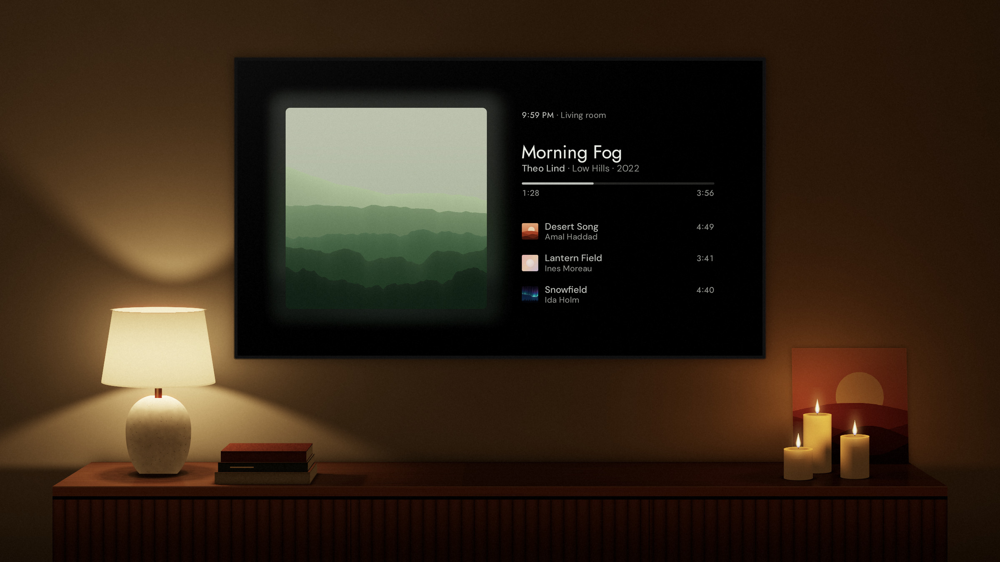

# Klangbild

[](#devices)
[](https://www.home-assistant.io)

<picture>
  <source media="(prefers-reduced-motion: no-preference)" srcset="docs/screenshots/film.avif" type="image/avif">
  <source media="(prefers-color-scheme: dark)" srcset="docs/screenshots/mockup-now-playing.jpg">
  
</picture>

Klangbild shows the music that's playing as a calm picture on your TV, so the biggest screen in the room is worth looking at while you listen. The design comes first. Everything has to look right from across the room, and whatever would make the picture busier stays out, even when it would be useful.

<a href="https://github.com/hazymorning/Klangbild/releases/latest/download/klangbild.apk"><picture><source media="(prefers-color-scheme: dark)" srcset="docs/screenshots/download.png"></picture></a>

## What it does

The album cover is the largest thing on the screen, with the title and artist beside it. There's no library, no search and nothing to press. You choose the music on your phone as usual, and the remote pauses and skips.

Klangbild works with any media player in Home Assistant. Music Assistant adds the queue, lyrics and audiobook chapters, the lights behind the TV can glow in the cover's colors, and with Sendspin the TV can play in time with your other speakers.

During the day the background is light, and at night it turns dark.


> [!NOTE]
> **Klangbild is being built in two&nbsp;phases.**<br>
> The first, the Now Playing screen, is nearly finished. Next comes a music visualizer that reacts to all kinds of things while staying calm and tasteful rather than psychedelic. Eventually, it will replace the landscape. Ideas are always welcome in the [Discussions](https://github.com/hazymorning/Klangbild/discussions), and if you'd like the landscape to stay, just say so in the&nbsp;[poll](https://github.com/hazymorning/Klangbild/discussions/51).

<a href="https://github.com/hazymorning/Klangbild/discussions/51"><picture><source media="(max-width: 640px) and (prefers-color-scheme: dark)" srcset="docs/screenshots/poll-small.png"><source media="(max-width: 640px)" srcset="docs/screenshots/poll-small-light.png"><source media="(prefers-color-scheme: dark)" srcset="docs/screenshots/poll.png"></picture></a>

## More

<a name="devices"></a>
<details>
<summary><b>Compatibility</b></summary>
<br>

Klangbild needs Android TV 9 or later, or a streaming stick whose system is built on Android 9 or newer. Since the TV can stay on for hours, the whole picture drifts slowly by a few pixels, which helps keep an OLED screen from burning in.

</details>

<details>
<summary><b>Setting it up</b></summary>
<br>

You need Home Assistant and a TV or box with Android TV 9 or later.

<details>
<summary><b>1. Install Klangbild on your TV</b></summary>
<br>

Klangbild isn't on Google Play, so you'll need to install the APK from the [latest release](https://github.com/hazymorning/Klangbild/releases/latest) yourself. The easiest way is to open the release page in the free Downloader app, select the APK and allow installs from unknown sources when Android asks.

</details>

<details>
<summary><b>2. Connect it to Home Assistant</b></summary>
<br>

The first time you open Klangbild, it shows a QR code. Scan it with your phone, sign in to Home Assistant and choose the speaker your music plays on. Everything happens on the phone, because no one likes typing on a remote. On the same page you can add Music Assistant, the lights behind your TV and a few buttons of your own for the quick settings, but all of that can wait.

> **Important**<br>
> If Music Assistant plays your music, your speaker usually shows up twice in the list, once from its own integration and once from Music Assistant. Choose the one marked Music Assistant, since only that one brings the queue, the lyrics and everything else Music Assistant knows about the song.

</details>

<details>
<summary><b>3. Open it automatically (optional)</b></summary>
<br>

If your TV is connected to Home Assistant through the Android Debug Bridge integration, an automation like this one opens Klangbild whenever your speaker starts playing:

```yaml
triggers:
  - trigger: state
    entity_id: media_player.living_room
    to: playing
actions:
  - action: media_player.select_source
    target:
      entity_id: media_player.tv
    data:
      source: io.github.hazymorning.klangbild
```

The two entity IDs are only examples, so put in the ones for your own speaker and TV.

</details>
<br>

</details>

<details>
<summary><b>TV remote</b></summary>
<br>

| Button | Action |
| --- | --- |
| OK | Play or pause (hold to open the settings) |
| Left / Right | Previous or next song |
| Up | Switch to the landscape |
| Down | Open the quick settings |

> In the settings you can change what some of the buttons do, for example to have up and down change the volume.

</details>

<details>
<summary><b>The queue</b></summary>
<br>

<table>
  <tr>
    <td width="33%" valign="top">
      <br>
      <b>Off</b>
    </td>
    <td width="33%" valign="top">
      <br>
      <b>List</b>
    </td>
    <td width="33%" valign="top">
      <br>
      <b>Cover Flow</b>
    </td>
  </tr>
</table>

Press the down button on the remote to open the quick settings, where you can choose how much of your queue you see. The list only works once you've added Music Assistant during setup, and until then Cover Flow mostly shows the covers of songs you've already heard.

</details>

<details>
<summary><b>Sendspin</b></summary>
<br>

With Music Assistant 2.10.7 or later, the TV can become one of its speakers and play in time with the others over Sendspin. Once "Play here" is on, under System in the settings or with the box on the setup page, it shows up in Music Assistant under its own name and keeps playing even while Klangbild is closed.

</details>

<details>
<summary><b>Landscape</b></summary>
<br>


There's also a landscape you can switch to, and it changes with the time of day, the seasons and the weather outside.

You'll see morning light, a sunset or stars depending on when you look, and if Home Assistant has a weather entity, it rains on screen when it rains outside. The up button on the remote takes you there at any time, and by default the landscape also comes up by itself after three minutes without music, which you can change or turn off in the settings.

</details>

<details>
<summary><b>Contributing</b></summary>
<br>

Design looks effortless when it's done well, and much of the work goes into what's left out. That's why ideas are best shared in the [Discussions](https://github.com/hazymorning/Klangbild/discussions) before anything is built. Bugs go in the [issues](https://github.com/hazymorning/Klangbild/issues).

</details>

<details>
<summary><b>Data privacy</b></summary>
<br>

Klangbild has no accounts and doesn't track you. Your Home Assistant login is stored encrypted on the TV and never goes anywhere but your own Home Assistant.

</details>
